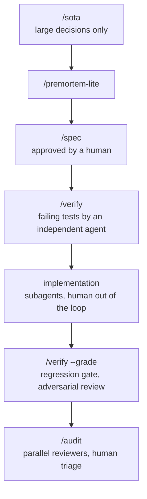

# Working rules for coding agents

The rules, skills and review agents I use to run Claude Code as a disciplined
engineering team rather than a fast typist. I use them every day.

Coding agents make writing code cheap. The bottleneck moves to judgment: what
to build, how to know it works, and when an agent is wrong. These files turn
that judgment into rules the agent has to follow.

## The rules — `CLAUDE.md`

A global instruction file loaded in every session. The core ideas:

- **Evidence before assertions.** Cite the exact source of every decisive fact;
  separate observations, inferences and hypotheses; an incomplete search is not
  proof of absence.
- **Independent review.** Before a consequential change, one reviewer with a
  fresh context — not the agent that wrote the work.
- **Pre-mortem.** For costly decisions, assume failure, name up to three causes,
  their early signals and the cheapest test.
- **Resource-aware delegation.** Pick the model and effort per role; claim a
  saving only after measuring it.
- **Simplify before automating.** Remove an unnecessary step rather than make
  it reliable.
- **No claimed gain without a baseline, a metric and a comparison.**

## The delivery chain — `skills/`



`/ship <slug>` orchestrates the chain: it detects the current phase from the
files under `.workflow/<slug>/` and resumes from there.

The key separation: **the spec author, the test author and the implementer are
three different agents**. The test author never sees the implementation. Humans
gate decisions — design approval, spec approval, finding triage — not typing.
Findings are never auto-fixed.

| Skill | What it does |
|---|---|
| `ship` | Lifecycle orchestrator, resumable from file state |
| `sota` | Three genuinely different approaches, one sourced recommendation |
| `premortem-lite` | Independent structural attack on a design or spec, citation-grounded |
| `spec` | Falsifiable spec: numeric acceptance criteria, concrete edge fixtures |
| `verify` | Failing tests from the spec by an independent agent; post-implementation grading |
| `audit` | Parallel multi-axis review, merged into one ranked findings file |
| `CONVENTIONS.md` | Shared rules: artifact layout, file handoffs, model per role |

## Review agents — `agents/`

- `elite-software-architect` — Clean Code / Clean Architecture review.
- `system-pressure-reviewer` — behavior under CPU, memory, disk and network pressure.
- `user-pressure-reviewer` — behavior under hostile or pathological user input.

## What I measured

I built a small benchmark to check these choices instead of trusting them.
June 2026, Claude Opus / Sonnet / Haiku versions of that time, N = 3 to 5 runs,
Wilson 95% confidence intervals (over defect × run pairs, which are not
independent, so the intervals are optimistic), decoys to measure false
positives. Code reviews are scored by line and keyword matching; skill outputs
by an LLM judge validated against hand labels (Cohen's κ ≥ 0.73).

- **Which model reviews best.** On a planted-defect battery (N = 5), the
  default reviewer is Sonnet: recall 0.75 [0.65–0.83], decoy false-positive
  rate 0.13 [0.04–0.38], $0.23 per review. Opus tends to find more
  (0.84 [0.74–0.90]) and to over-flag (0.47 [0.25–0.70]) at $0.41. The
  intervals overlap and one of the three decoys is debatable, so read the gap
  as a trend. A precision guard removed Opus's false positives but dropped its
  recall to 0.72.
- **File handoffs.** Agents write findings to files and return a summary.
  Projected from captured outputs, the orchestrator keeps about 96% less
  context per turn, provided it opens the full files only on demand (about 85%
  over 8 turns if it reads them all). A generic "≤15-line summary" dropped ~5% of serious
  defects; requiring every serious finding in the summary closed the gap
  (fidelity 0.95 → 1.00). The context saving was not re-measured with that
  longer summary.
- **Task decomposition is not a clear defect-catching win** (inconclusive at
  N = 3). Per-task review missed cross-task defects; the final whole-branch
  audit is what caught them.
- **End to end.** One full run (N = 1) on a small benchmark feature: autonomous
  implementation to green; the grade and audit phases caught a race condition
  and a memory leak that the per-task reviews missed.

Details, methods and limits: [`docs/measurements/`](docs/measurements/).

## Limits

- Small batteries built by me, on my use cases. This is evidence for my
  choices, not a general benchmark, and model updates can change the results.
- The benchmark harness (scripts and fixtures) is not published yet.
- The two pressure reviewers are early drafts, not benchmarked.
- `/audit` relies on the `code-reviewer`, `security-auditor` and
  `architect-review` agents from the `comprehensive-review` plugin
  ([wshobson/agents](https://github.com/wshobson/agents) marketplace),
  installed separately. `/sota` uses the Context7 plugin for library docs
  when it is installed.
- `/ship --grill` expects a separate `grill-me` skill, for example
  [Matt Pocock's](https://github.com/mattpocock/skills).
- I make no claim about team velocity. The measured claims are the ones above.

## Install

```bash
mkdir -p ~/.claude/skills ~/.claude/agents
cp -n CLAUDE.md ~/.claude/CLAUDE.md   # never overwrites yours: merge by hand
cp -R skills/* ~/.claude/skills/
cp agents/*.md ~/.claude/agents/
```

Adapt `CLAUDE.md` to your context — it encodes my preferences, not universal truths.

## License

MIT — see [`LICENSE`](LICENSE).
